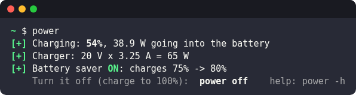
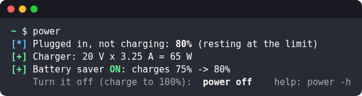
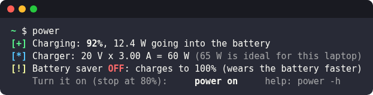
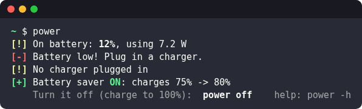
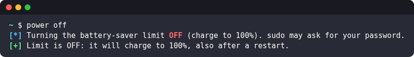
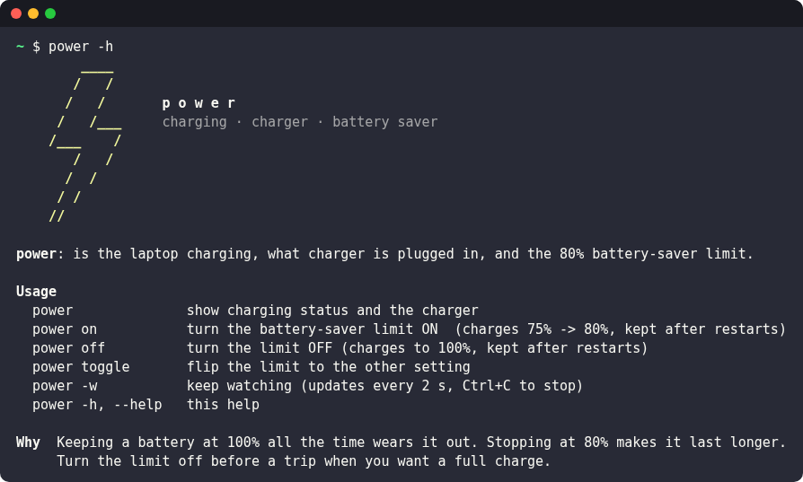
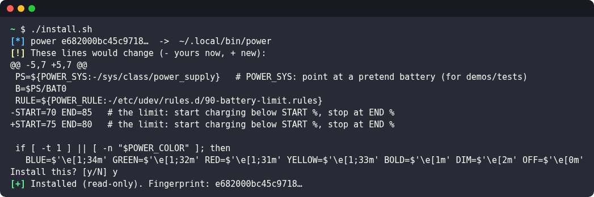

# ⚡ power

A tiny Linux command that tells you **if your laptop is charging**, **what charger is plugged in** (volts × amps =
watts), and switches a **battery-saver limit** (stop charging at 80%) on and off. Metasploit-style status lines.

<p align="center"></p>

## What it shows

| | |
|:-:|:-:|
| <br>Plugged in, resting at the 80% limit | <br>Limit off: a warning, and how to turn it on |
| <br>On battery and low | <br>`power off` / `power on` switch the limit |

- `[+]` good · `[*]` info · `[!]` warning · `[-]` problem
- Rates the charger: **65 W+** good, **45–64 W** OK, under 45 W too weak (tuned for a ThinkPad T14; change it in the script)

## Usage

<p align="center"></p>

```
power              show charging status and the charger
power on           battery-saver limit ON (charges 75% -> 80%, kept after restarts)
power off          limit OFF (charges to 100%, kept after restarts)
power toggle       flip the limit
power -w           keep watching (every 2 s)
power -h, --help   help
```

## Install (safely)

`power` uses `sudo`, so don't run a copy you haven't looked at, and don't let it update itself.

```bash
git clone https://github.com/604Security/power && cd power
less power          # read it first
./install.sh        # installs a read-only copy to ~/.local/bin/power
```

<p align="center"></p>

- Your installed copy is **frozen**: it doesn't change when this repo changes. To update, `git pull`, then
  `./install.sh` shows **exactly which lines change** and asks before installing.
- Check you have the reviewed release: **v1.0.0** `power` sha256 is
  `e682000bc45c9718f1a98d88cc90b70bda2da8cc18fd5a15f0d574a535a39e14` (`sha256sum power`).

## How it works
- Reads `/sys/class/power_supply/BAT0` (status, %, watts) and the USB-C charger (`ucsi-source-psy-*`: max volts × amps).
- The limit uses the kernel's `charge_control_start_threshold` / `charge_control_end_threshold` (ThinkPads and many
  other laptops). `power on/off` sets them with `sudo` and writes or removes a udev rule
  (`/etc/udev/rules.d/90-battery-limit.rules`) so the setting survives a restart.
- `sudo` needs a real terminal to ask for your password.

## Screenshots
Made by `python3 tools/screenshots.py`: it runs `power` against **pretend batteries** (`POWER_SYS=` a fake
`/sys/class/power_supply`, plus a pretend `sudo`), so the pictures show every situation without touching the real
battery.

## Credits
By [DFIR-life](https://github.com/DFIR-life). MIT licence.
